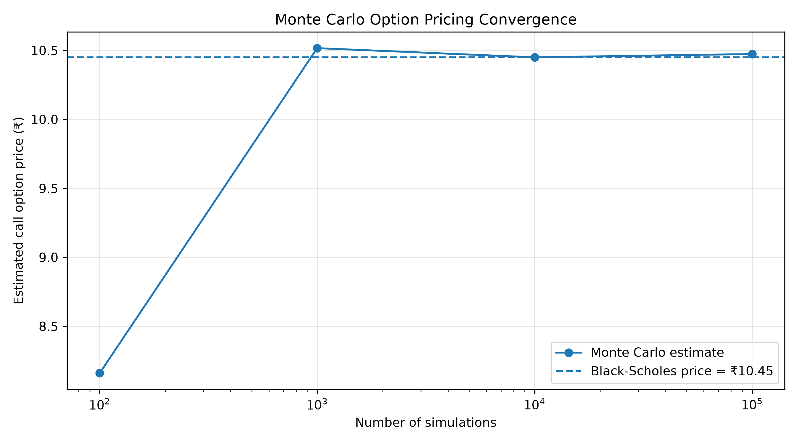
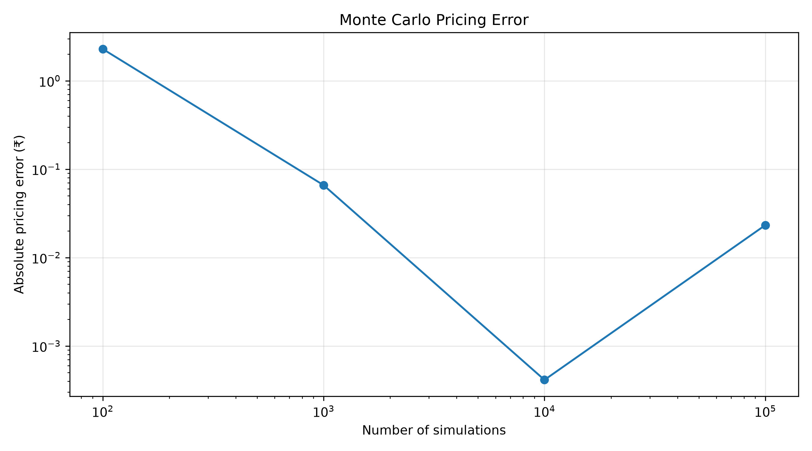
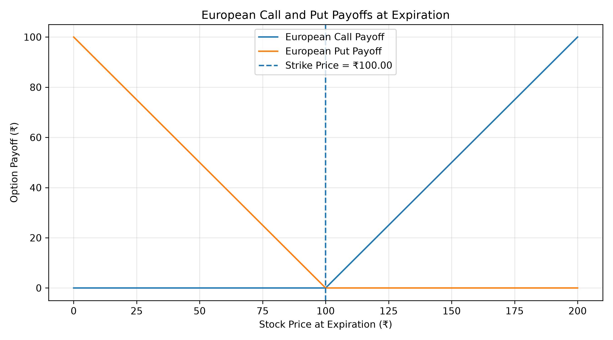

# Monte Carlo Option Pricer

A quantitative finance project that prices European call and put options using Monte Carlo simulation and validates the results against the Black–Scholes model.

## Overview

This project simulates possible stock prices at option expiry using risk-neutral geometric Brownian motion (GBM). It estimates option prices from discounted payoffs, compares them with analytical Black–Scholes prices, and studies how simulation size affects pricing accuracy.

## Features

- European call and put option pricing
- Risk-neutral geometric Brownian motion
- Black–Scholes benchmark comparison
- Monte Carlo convergence analysis
- Absolute pricing error visualization
- Call and put payoff diagrams
- Automated tests using Python `unittest`

## Mathematical Method

### 1. Simulating the stock price

The terminal stock price follows:

\[
S_T=S_0\exp\left[\left(r-\frac{\sigma^2}{2}\right)T+\sigma\sqrt{T}Z\right]
\]

Where \(S_0\) is the initial price, \(r\) is the risk-free rate, \(\sigma\) is annual volatility, \(T\) is time to expiry in years, and \(Z\) is a standard normal random variable.

### 2. Pricing options

The Monte Carlo estimate is the discounted average payoff.

**European call:**

\[
C=e^{-rT}\frac{1}{N}\sum_{i=1}^{N}\max(S_T^{(i)}-K,0)
\]

**European put:**

\[
P=e^{-rT}\frac{1}{N}\sum_{i=1}^{N}\max(K-S_T^{(i)},0)
\]

Here, \(K\) is the strike price and \(N\) is the number of simulations.

## Parameters

| Parameter | Value |
|---|---:|
| Initial stock price | 100 |
| Strike price | 100 |
| Time to expiry | 1 year |
| Risk-free rate | 5% |
| Annual volatility | 20% |
| Main simulation count | 10,000 |

## Results

Example output from the current implementation:

| Metric | Value |
|---|---:|
| Monte Carlo call price | 10.45 |
| Black–Scholes call price | 10.45 |
| Monte Carlo put price | 5.60 |
| Black–Scholes put price | 5.57 |

Monte Carlo estimates depend on random sampling. Small differences from Black–Scholes are expected; increasing the number of simulations generally reduces sampling error.

## Visualizations

### Monte Carlo convergence



### Absolute pricing error



### Option payoff diagrams



## Installation

Clone the repository and enter the project directory:

```bash
git clone YOUR_REPOSITORY_URL
cd monte-carlo-option-pricer
```

Create and activate a virtual environment:

```bash
python3 -m venv .venv
source .venv/bin/activate
```

Install dependencies:

```bash
pip install -r requirements.txt
```

## Usage

Run the pricing simulation:

```bash
python main.py
```

Run the automated tests:

```bash
python -m unittest test_pricer.py
```

## Project Structure

```text
monte-carlo-option-pricer/
├── main.py
├── test_pricer.py
├─requirements.txt
├── convergence.png
├── convergence_error.png
├── option_payoffs.png
├── README.md
└── .gitignore
```

## Limitations

- Assumes constant volatility and risk-free interest rates.
- Uses a geometric Brownian motion model.
- Prices European options under standard Black–Scholes assumptions.
- Does not account for transaction costs, liquidity, or jumps in stock prices.

## Future Improvements

- Confidence intervals for Monte Carlo estimates
- Variance reduction using antithetic variates
- Option Greeks estimation
- Implied volatility analysis
- Performance benchmarking for larger simulations

#Discalimer It is not investment advice
